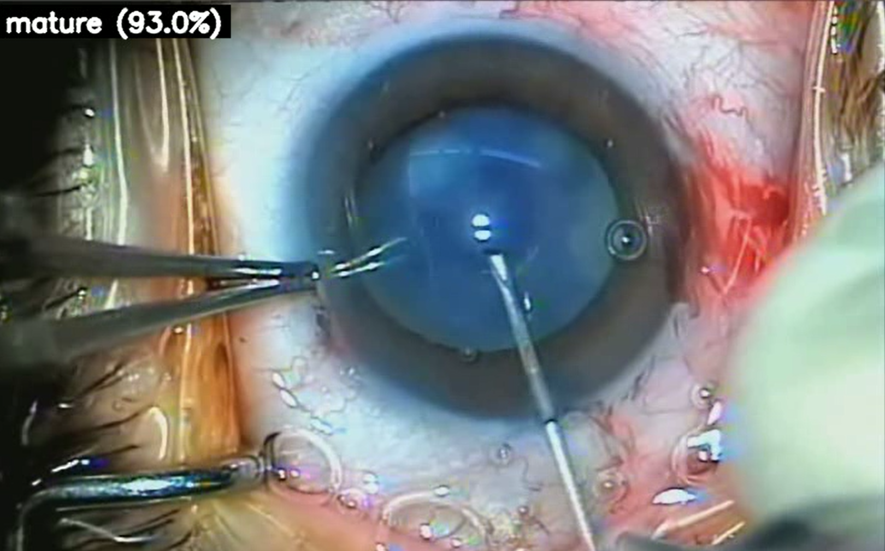

# Cataract Surgery Difficulty Classification

  

  <em>Illustrative frame-level prediction. The displayed score is not the overall classification accuracy.</em>

Deep learning experiments for assessing **cataract severity** and **poor pupil dilation** from surgical microscope images selected around the beginning of capsulorhexis.

This repository contains individual CNN training notebooks, task-specific transformer benchmarks, CNN hyperparameter optimization with Optuna, and grouped K-fold evaluation implementations.

---

## Problem Overview

Cataract severity and inadequate pupil dilation are two visual factors associated with surgical difficulty. Identifying these attributes from microscope images can support the study of surgical conditions and automated analysis of surgical video.

This project investigates two separate classification tasks rather than combining all conditions into a single difficulty scale.

## Classification Tasks

### Cataract severity

Four-class classification of cataract appearance:

| Model label | Class |
| --- | --- |
| `0` | Low nuclear density |
| `1` | Dense |
| `2` | Mature |
| `3` | Brunescent |

### Poor pupil dilation

Binary classification of pupil dilation:

| Model label | Class |
| --- | --- |
| `0` | Normal dilation |
| `1` | Poor dilation |

Poor dilation is a separate task, not a fifth cataract severity class. The values above are zero-based model labels; original metadata may represent classes using one-hot columns.

---

## Dataset

The experiments use annotated surgical microscope frames with task-specific labels and source-video identifiers.

Frames originating from the same video are kept together during data partitioning. This prevents frames from a recorded video from appearing in both training and held-out partitions.

Required metadata formats, image layouts, and data-source settings are documented in the corresponding experiment folders. Image archives and metadata are obtained separately from the repository.

A Hugging Face dataset link will be added when the dataset release is available.

---

## Methods

The project evaluates pretrained convolutional neural networks and vision transformers through transfer learning.

### Convolutional neural networks

- ResNet-18, ResNet-34, and ResNet-50
- DenseNet-121 and DenseNet-169
- EfficientNet-B1 through EfficientNet-B5
- VGG-16 for cataract severity

The final CNN notebooks retain architecture-specific configurations, including input resolution, trainable layers, learning rates, class sampling, and loss settings.

### Vision transformers

- ViT-B/16 and ViT-B/32
- DeiT-Tiny, DeiT-Small, and DeiT-Base
- DeiT-Small-Distilled
- Swin-Tiny, Swin-Small, and Swin-Base

Two task-specific notebooks benchmark these architectures. Their documented starting configurations are separate from the CNN Optuna studies.

### Hyperparameter optimization

The Optuna implementation searches CNN backbone and classifier learning rates, weight decay, and label smoothing using validation macro-F1.

Its selected parameters are saved with each experiment. They are not automatically transferred into the final notebooks or K-fold configuration file.

---

## Experiment Workflows

| Workflow | Purpose | Implementation |
| --- | --- | --- |
| [Final CNN notebooks](Codes/notebooks/cnn/) | Train and evaluate individual CNNs using retained final configurations | One notebook per architecture and task |
| [Transformer benchmarks](Codes/notebooks/transformer/) | Compare transformer architectures on a single grouped train/validation/test split | One multi-model notebook per task |
| [Optuna](Codes/Optuna/ReadMe.md) | Search CNN hyperparameters, then train and evaluate a fresh model | Python modules and a historical Kaggle launcher |
| [CNN K-fold](Codes/K%20Fold/cnn%20models/ReadMe.md) | Evaluate retained CNN configurations across grouped folds | Modular Python implementation |
| [Transformer K-fold](Codes/K%20Fold/transformer%20models/) | Evaluate a configurable transformer subset across grouped folds | One standalone notebook per task |

Configuration details differ between workflows. Each folder README explains its required inputs, training settings, checkpoint selection, outputs, and restart behavior.

---

## Evaluation

The single-split experiments use video-grouped training, validation, and test partitions. The K-fold implementations use `StratifiedGroupKFold`, with five folds by default.

Reported metrics include:

- Accuracy
- Macro-F1 and weighted-F1
- Per-class precision, recall, F1, and support
- Confusion matrices
- ROC-AUC where implemented

K-fold outputs distinguish completed-fold mean and standard deviation from metrics computed using pooled out-of-fold predictions.

The K-fold implementations select checkpoints using the held-out validation fold and report performance on that same fold. These are validation cross-validation results, rather than an additional independent test evaluation.

Grouping is implemented using video identifiers. Establishing patient-level independence across different videos requires a verified video-to-patient mapping.

---

## Running the Experiments

1. Select the workflow from the table above.
2. Read its folder README and configure the required metadata and image paths.
3. Install the dependencies specified for that workflow.
4. Run the available metadata and split checks.
5. Train the selected models and preserve their outputs.

The original CNN notebooks target Google Colab. Transformer notebooks target Kaggle, with GPU scheduling described in their documentation. The CNN K-fold and Optuna Python runners execute sequential jobs on one selected device per process.

The root `requirements.txt` is a general dependency list. Workflow-specific dependencies and environment assumptions are documented within each implementation.

---

## Results

The original CNN notebooks retain outputs from their individual experiments. Training and evaluation workflows also generate metrics, predictions, checkpoints, and diagnostic artifacts according to their implementation.

The [results folder](results/README.md) currently contains the prediction example displayed above. Complete benchmark tables will be added with their dataset version, evaluation protocol, and completed-run coverage.

The current experiments evaluate frame-level classification of the two target attributes. The example image illustrates a model prediction; it does not establish video-level or clinical performance.

---

## Repository Structure

| Location | Contents |
| --- | --- |
| [Codes/](Codes/ReadMe.md) | Guide to the experiment implementations |
| [Codes/notebooks/](Codes/notebooks/) | Final CNN notebooks and single-split transformer benchmarks |
| [Codes/Optuna/](Codes/Optuna/ReadMe.md) | CNN hyperparameter search and final-training pipeline |
| [Codes/K Fold/](Codes/K%20Fold/ReadMe.md) | CNN Python and transformer notebook cross-validation implementations |
| [results/](results/README.md) | Prediction example and result documentation |
| [reports/](reports/README.md) | Historical Persian internship report |

---

## Author

**Yazdan Bayat**  
Electrical Engineering — AI and Robotics  
K. N. Toosi University of Technology  
ARAS Laboratory

[GitHub](https://github.com/YzdnByat) · [Hugging Face](https://huggingface.co/yzdnbyat)

## Licensing

A repository software license has not yet been specified. Dataset, source-video, pretrained-model, and third-party software terms apply separately.
