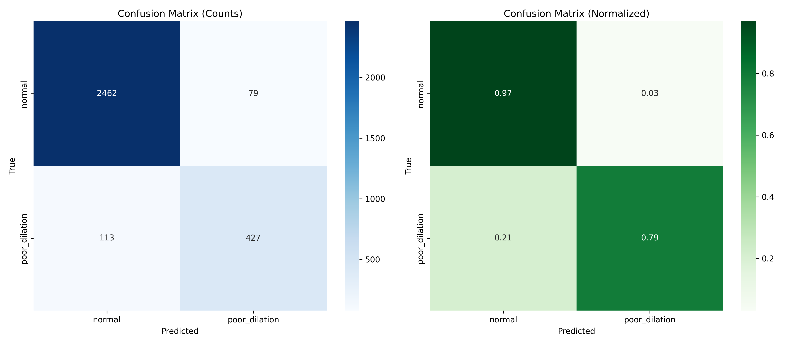

# Poor pupil dilation — CNN K-fold results

[Back to CNN results](../) · [All results](../../../README.md)

10 models evaluated on 3,081 frames from 700 video-ID groups. Each model has five completed folds; the recorded split seed is **42**.

## Model comparison

Values are **mean ± sample standard deviation across five folds, in percent**. Rows are ordered by mean macro-F1; the order describes these runs and does not establish statistical significance.

| Model | Accuracy (%) | Macro-F1 (%) | Weighted-F1 (%) | ROC-AUC (%) | Details |
| --- | ---: | ---: | ---: | ---: | --- |
| [ResNet50](resnet50/) | 93.87 ± 2.68 | 88.87 ± 3.70 | 93.78 ± 2.77 | 96.24 ± 1.70 | [Folds](resnet50/fold_metrics.csv) · [Confusion matrix](resnet50/oof_confusion_matrix.png) · [Curves](resnet50/training_curves.png) |
| [ResNet34](resnet34/) | 93.54 ± 3.85 | 88.40 ± 4.59 | 93.28 ± 4.13 | 93.98 ± 2.96 | [Folds](resnet34/fold_metrics.csv) · [Confusion matrix](resnet34/oof_confusion_matrix.png) · [Curves](resnet34/training_curves.png) |
| [EfficientNet-B2](efficientnet_b2/) | 93.16 ± 3.62 | 87.96 ± 4.51 | 93.07 ± 3.83 | 95.20 ± 2.67 | [Folds](efficientnet_b2/fold_metrics.csv) · [Confusion matrix](efficientnet_b2/oof_confusion_matrix.png) · [Curves](efficientnet_b2/training_curves.png) |
| [ResNet18](resnet18/) | 93.05 ± 3.05 | 87.43 ± 3.06 | 92.90 ± 3.16 | 93.75 ± 3.07 | [Folds](resnet18/fold_metrics.csv) · [Confusion matrix](resnet18/oof_confusion_matrix.png) · [Curves](resnet18/training_curves.png) |
| [DenseNet121](densenet121/) | 91.85 ± 3.85 | 86.11 ± 3.19 | 91.90 ± 3.84 | 94.59 ± 1.84 | [Folds](densenet121/fold_metrics.csv) · [Confusion matrix](densenet121/oof_confusion_matrix.png) · [Curves](densenet121/training_curves.png) |
| [EfficientNet-B1](efficientnet_b1/) | 92.00 ± 3.12 | 86.09 ± 3.23 | 92.04 ± 3.28 | 95.25 ± 2.14 | [Folds](efficientnet_b1/fold_metrics.csv) · [Confusion matrix](efficientnet_b1/oof_confusion_matrix.png) · [Curves](efficientnet_b1/training_curves.png) |
| [DenseNet169](densenet169/) | 92.06 ± 2.93 | 85.68 ± 3.34 | 91.98 ± 3.15 | 93.68 ± 2.32 | [Folds](densenet169/fold_metrics.csv) · [Confusion matrix](densenet169/oof_confusion_matrix.png) · [Curves](densenet169/training_curves.png) |
| [EfficientNet-B3](efficientnet_b3/) | 89.32 ± 3.14 | 82.19 ± 2.62 | 89.59 ± 3.41 | 92.96 ± 2.29 | [Folds](efficientnet_b3/fold_metrics.csv) · [Confusion matrix](efficientnet_b3/oof_confusion_matrix.png) · [Curves](efficientnet_b3/training_curves.png) |
| [EfficientNet-B4](efficientnet_b4/) | 86.14 ± 2.35 | 75.81 ± 1.67 | 86.31 ± 2.80 | 87.32 ± 1.69 | [Folds](efficientnet_b4/fold_metrics.csv) · [Confusion matrix](efficientnet_b4/oof_confusion_matrix.png) · [Curves](efficientnet_b4/training_curves.png) |
| [EfficientNet-B5](efficientnet_b5/) | 81.82 ± 1.83 | 72.66 ± 3.94 | 83.25 ± 2.30 | 86.28 ± 5.10 | [Folds](efficientnet_b5/fold_metrics.csv) · [Confusion matrix](efficientnet_b5/oof_confusion_matrix.png) · [Curves](efficientnet_b5/training_curves.png) |

[Download comparison data](model_comparison.csv) · [Exact fold assignments](fold_assignments.csv) · [Evaluation and recorded configurations](protocol.json)

## Reading the results

The held-out fold is used to select the checkpoint with minimum validation loss and to report its scores. These are frame-level validation cross-validation results. Splits separate video IDs; the supplied records do not establish distinct patients across video IDs.

CSV scores remain fractions from 0 to 1. For example, `0.90` means 90%. `*_mean` and `*_std` summarize the five folds; `oof_*` combines every held-out prediction once. Pooled scores can differ from the fold mean. SD describes variation across folds and is not a confidence interval.

For poor dilation, `poor_recall` is sensitivity for class 1, `poor_precision` is its precision, and `specificity` is recall for normal eyes (class 0). These additional scores are in the CSV files.

## Classes

| Label index | Class | Frames |
| --- | --- | ---: |
| 0 | normal | 2,541 |
| 1 | poor_dilation | 540 |

## Files in each model folder

| File | Contents |
| --- | --- |
| `fold_metrics.csv` | Five rows: selected epoch, epochs trained, minimum validation loss, and scores. |
| `per_class_metrics.csv` | Pooled held-out precision, recall, F1, and support for each class. |
| `oof_confusion_matrix.png` | Confusion matrix combining held-out predictions from all five folds. |
| `oof_confusion_matrix_counts.csv` | Exact integer counts behind that matrix; rows are truth, columns are predictions. |
| `training_curves.png` | Training and validation histories for all five folds. |

The figures describe the archived runs. Training accuracy reflects the training sampler and augmentation. Curves may continue after the selected epoch because checkpoint selection uses the lowest validation loss.

## Example: ResNet50

This model has the highest mean macro-F1 in this group. The matrix combines all five held-out folds.

## Complete experiment records

The original `CNN-KFold-Results(1).zip` contains per-fold histories, predictions, logs, and verification records. This folder provides the compact presentation of those results. No training was rerun.
