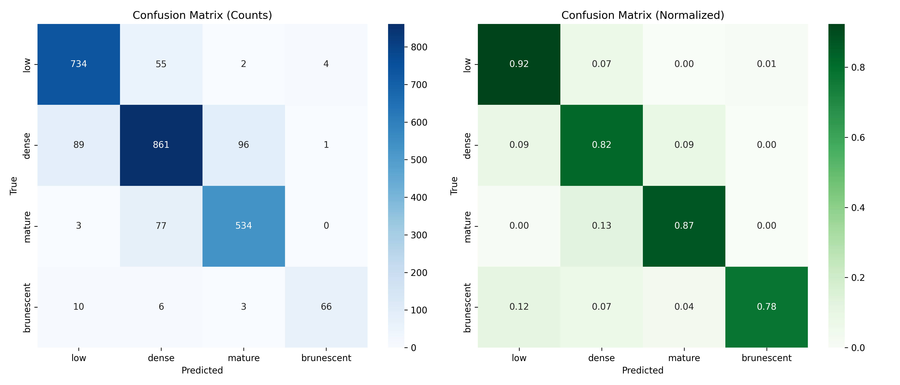

# Cataract severity — CNN K-fold results

[Back to CNN results](../) · [All results](../../../README.md)

11 models evaluated on 2,541 frames from 645 video-ID groups. Each model has five completed folds; the recorded split seed is **42**.

## Model comparison

Values are **mean ± sample standard deviation across five folds, in percent**. Rows are ordered by mean macro-F1; the order describes these runs and does not establish statistical significance.

| Model | Accuracy (%) | Macro-F1 (%) | Weighted-F1 (%) | ROC-AUC (%) | Details |
| --- | ---: | ---: | ---: | ---: | --- |
| [ResNet50](resnet50/) | 86.42 ± 2.78 | 86.05 ± 2.07 | 86.42 ± 2.71 | 96.90 ± 1.16 | [Folds](resnet50/fold_metrics.csv) · [Confusion matrix](resnet50/oof_confusion_matrix.png) · [Curves](resnet50/training_curves.png) |
| [EfficientNet-B1](efficientnet_b1/) | 85.47 ± 1.66 | 85.12 ± 1.84 | 85.48 ± 1.69 | 96.98 ± 0.55 | [Folds](efficientnet_b1/fold_metrics.csv) · [Confusion matrix](efficientnet_b1/oof_confusion_matrix.png) · [Curves](efficientnet_b1/training_curves.png) |
| [EfficientNet-B5](efficientnet_b5/) | 85.73 ± 1.03 | 84.97 ± 2.28 | 85.72 ± 1.00 | 96.72 ± 0.64 | [Folds](efficientnet_b5/fold_metrics.csv) · [Confusion matrix](efficientnet_b5/oof_confusion_matrix.png) · [Curves](efficientnet_b5/training_curves.png) |
| [ResNet34](resnet34/) | 85.24 ± 2.32 | 83.66 ± 2.99 | 85.18 ± 2.27 | 96.78 ± 0.71 | [Folds](resnet34/fold_metrics.csv) · [Confusion matrix](resnet34/oof_confusion_matrix.png) · [Curves](resnet34/training_curves.png) |
| [EfficientNet-B2](efficientnet_b2/) | 84.82 ± 2.36 | 83.53 ± 5.01 | 84.79 ± 2.42 | 96.68 ± 0.74 | [Folds](efficientnet_b2/fold_metrics.csv) · [Confusion matrix](efficientnet_b2/oof_confusion_matrix.png) · [Curves](efficientnet_b2/training_curves.png) |
| [ResNet18](resnet18/) | 85.87 ± 2.63 | 83.51 ± 0.55 | 85.83 ± 2.54 | 97.00 ± 0.99 | [Folds](resnet18/fold_metrics.csv) · [Confusion matrix](resnet18/oof_confusion_matrix.png) · [Curves](resnet18/training_curves.png) |
| [EfficientNet-B3](efficientnet_b3/) | 83.40 ± 3.38 | 83.00 ± 4.17 | 83.45 ± 3.32 | 96.03 ± 1.09 | [Folds](efficientnet_b3/fold_metrics.csv) · [Confusion matrix](efficientnet_b3/oof_confusion_matrix.png) · [Curves](efficientnet_b3/training_curves.png) |
| [VGG16](vgg16/) | 82.81 ± 2.26 | 81.60 ± 1.92 | 82.80 ± 2.19 | 95.05 ± 1.28 | [Folds](vgg16/fold_metrics.csv) · [Confusion matrix](vgg16/oof_confusion_matrix.png) · [Curves](vgg16/training_curves.png) |
| [EfficientNet-B4](efficientnet_b4/) | 81.49 ± 2.81 | 81.04 ± 1.48 | 81.56 ± 2.72 | 95.03 ± 0.88 | [Folds](efficientnet_b4/fold_metrics.csv) · [Confusion matrix](efficientnet_b4/oof_confusion_matrix.png) · [Curves](efficientnet_b4/training_curves.png) |
| [DenseNet169](densenet169/) | 81.56 ± 0.67 | 80.74 ± 1.21 | 81.54 ± 0.66 | 95.22 ± 0.73 | [Folds](densenet169/fold_metrics.csv) · [Confusion matrix](densenet169/oof_confusion_matrix.png) · [Curves](densenet169/training_curves.png) |
| [DenseNet121](densenet121/) | 80.87 ± 2.93 | 77.89 ± 3.68 | 80.85 ± 2.87 | 94.84 ± 0.87 | [Folds](densenet121/fold_metrics.csv) · [Confusion matrix](densenet121/oof_confusion_matrix.png) · [Curves](densenet121/training_curves.png) |

[Download comparison data](model_comparison.csv) · [Exact fold assignments](fold_assignments.csv) · [Evaluation and recorded configurations](protocol.json)

## Reading the results

The held-out fold is used to select the checkpoint with minimum validation loss and to report its scores. These are frame-level validation cross-validation results. Splits separate video IDs; the supplied records do not establish distinct patients across video IDs.

CSV scores remain fractions from 0 to 1. For example, `0.90` means 90%. `*_mean` and `*_std` summarize the five folds; `oof_*` combines every held-out prediction once. Pooled scores can differ from the fold mean. SD describes variation across folds and is not a confidence interval.

`low` and `low nuclear density` refer to the same class.

## Classes

| Label index | Class | Frames |
| --- | --- | ---: |
| 0 | low | 795 |
| 1 | dense | 1,047 |
| 2 | mature | 614 |
| 3 | brunescent | 85 |

## Files in each model folder

| File | Contents |
| --- | --- |
| `fold_metrics.csv` | Five rows: selected epoch, epochs trained, minimum validation loss, and scores. |
| `per_class_metrics.csv` | Pooled held-out precision, recall, F1, and support for each class. |
| `oof_confusion_matrix.png` | Confusion matrix combining held-out predictions from all five folds. |
| `oof_confusion_matrix_counts.csv` | Exact integer counts behind that matrix; rows are truth, columns are predictions. |
| `training_curves.png` | Training and validation histories for all five folds. |

The figures describe the archived runs. Training accuracy reflects the training sampler and augmentation. Curves may continue after the selected epoch because checkpoint selection uses the lowest validation loss.

## Example: ResNet50

This model has the highest mean macro-F1 in this group. The matrix combines all five held-out folds.

## Complete experiment records

The original `CNN-KFold-Results(1).zip` contains per-fold histories, predictions, logs, and verification records. This folder provides the compact presentation of those results. No training was rerun.
