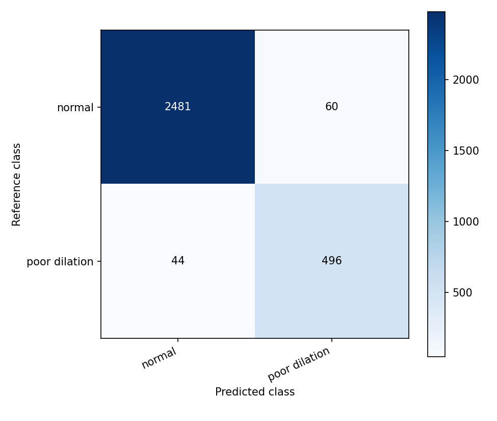

# Poor pupil dilation — Transformer K-fold results

[Back to Transformer results](../) · [All results](../../../README.md)

4 models evaluated on 3,081 frames from 700 video-ID groups. Each model has five completed folds; the recorded split seed is **42**.

## Model comparison

Values are **mean ± sample standard deviation across five folds, in percent**. Rows are ordered by mean macro-F1; the order describes these runs and does not establish statistical significance.

| Model | Accuracy (%) | Macro-F1 (%) | Weighted-F1 (%) | ROC-AUC (%) | Details |
| --- | ---: | ---: | ---: | ---: | --- |
| [ViT-B/16](ViT-B_16/) | 96.68 ± 1.29 | 94.33 ± 1.00 | 96.70 ± 1.30 | 97.78 ± 1.67 | [Folds](ViT-B_16/fold_metrics.csv) · [Confusion matrix](ViT-B_16/oof_confusion_matrix.png) · [Curves](ViT-B_16/training_curves.png) |
| [Swin-Small](Swin-Small/) | 96.54 ± 1.35 | 94.08 ± 1.85 | 96.58 ± 1.34 | 98.23 ± 1.90 | [Folds](Swin-Small/fold_metrics.csv) · [Confusion matrix](Swin-Small/oof_confusion_matrix.png) · [Curves](Swin-Small/training_curves.png) |
| [Swin-Tiny](Swin-Tiny/) | 96.05 ± 0.90 | 93.05 ± 0.46 | 96.08 ± 0.92 | 98.27 ± 0.98 | [Folds](Swin-Tiny/fold_metrics.csv) · [Confusion matrix](Swin-Tiny/oof_confusion_matrix.png) · [Curves](Swin-Tiny/training_curves.png) |
| [DeiT-Small](DeiT-Small/) | 95.33 ± 1.80 | 91.86 ± 2.20 | 95.34 ± 1.84 | 97.55 ± 1.48 | [Folds](DeiT-Small/fold_metrics.csv) · [Confusion matrix](DeiT-Small/oof_confusion_matrix.png) · [Curves](DeiT-Small/training_curves.png) |

[Download comparison data](model_comparison.csv) · [Exact fold assignments](fold_assignments.csv) · [Evaluation and recorded configurations](protocol.json)

## Reading the results

The held-out fold is used to select the checkpoint with minimum validation loss and to report its scores. These are frame-level validation cross-validation results. Splits separate video IDs; the supplied records do not establish distinct patients across video IDs.

CSV scores remain fractions from 0 to 1. For example, `0.90` means 90%. `*_mean` and `*_std` summarize the five folds; `oof_*` combines every held-out prediction once. Pooled scores can differ from the fold mean. SD describes variation across folds and is not a confidence interval.

For poor dilation, `poor_recall` is sensitivity for class 1, `poor_precision` is its precision, and `specificity` is recall for normal eyes (class 0). These additional scores are in the CSV files.

## Classes

| Label index | Class | Frames |
| --- | --- | ---: |
| 0 | normal | 2,541 |
| 1 | poor dilation | 540 |

## Files in each model folder

| File | Contents |
| --- | --- |
| `fold_metrics.csv` | Five rows: selected epoch, epochs trained, minimum validation loss, and scores. |
| `per_class_metrics.csv` | Pooled held-out precision, recall, F1, and support for each class. |
| `oof_confusion_matrix.png` | Confusion matrix combining held-out predictions from all five folds. |
| `oof_confusion_matrix_counts.csv` | Exact integer counts behind that matrix; rows are truth, columns are predictions. |
| `training_curves.png` | Training and validation histories for all five folds. |

The figures describe the archived runs. Training accuracy reflects the training sampler and augmentation. Curves may continue after the selected epoch because checkpoint selection uses the lowest validation loss.

## Example: ViT-B/16

This model has the highest mean macro-F1 in this group. The matrix combines all five held-out folds.

## Complete experiment records

The original `Transformer-KFold-Results(1).zip` contains per-fold histories, predictions, logs, and verification records. This folder provides the compact presentation of those results. No training was rerun.
