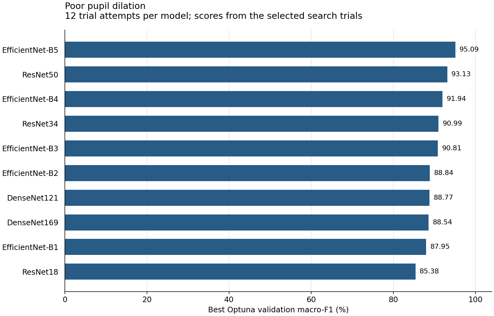

# Poor pupil dilation — Optuna results

[Back to the Optuna overview](../README.md)

I optimized ten CNN architectures for poor pupil dilation, using 12 Optuna trial attempts per model. My target classes were normal and poor pupil dilation.

## Main findings

I obtained the highest search validation macro-F1 with **EfficientNet-B5 (95.09%)**. Its final test accuracy was **96.69%**, and its test macro-F1 was **94.16%**.

On the test partition, this model identified 70 of 74 poor-dilation frames and 368 of 379 normal frames correctly. Poor-dilation sensitivity was **94.59%**. I report macro-F1 alongside accuracy to account for the unequal class frequencies.

## Model comparison

I order models by their best **search validation macro-F1**. Test scores describe the separately trained final checkpoints. All values below are percentages.

| Model | Search val. macro-F1 (%) | Test accuracy (%) | Test macro-F1 (%) |
| --- | ---: | ---: | ---: |
| EfficientNet-B5 | 95.09 | 96.69 | 94.16 |
| ResNet50 | 93.13 | 96.47 | 93.68 |
| EfficientNet-B4 | 91.94 | 94.70 | 90.31 |
| ResNet34 | 90.99 | 94.26 | 90.03 |
| EfficientNet-B3 | 90.81 | 95.14 | 91.21 |
| EfficientNet-B2 | 88.84 | 91.61 | 84.31 |
| DenseNet121 | 88.77 | 92.49 | 87.34 |
| DenseNet169 | 88.54 | 92.94 | 87.73 |
| EfficientNet-B1 | 87.95 | 94.04 | 89.60 |
| ResNet18 | 85.38 | 93.60 | 87.68 |

## Selected settings and numerical results

- [`best_hyperparameters.csv`](best_hyperparameters.csv): the selected head/backbone learning rates, weight decay, and label smoothing for every model. I also include the recorded input resolution and batch size.
- [`results.csv`](results.csv): full-precision search validation, final training validation, and test metrics, including weighted-F1 and ROC-AUC. Scores are fractions in [0, 1]; for example, `0.90` means 90%.

I used 2,141 training frames, 487 validation frames, and 453 test frames. Video IDs do not overlap between the three partitions. I selected trials and final checkpoints using validation macro-F1 and report these fixed-split results separately from K-fold evaluation.
