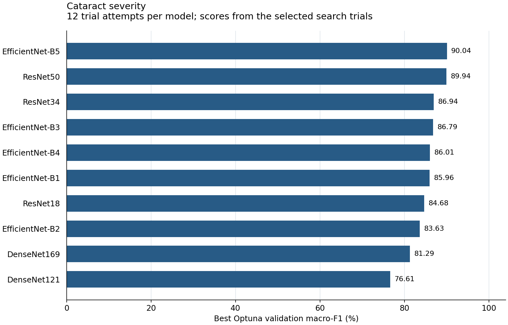

# Cataract severity — Optuna results

[Back to the Optuna overview](../README.md)

I optimized ten CNN architectures for cataract severity, using 12 Optuna trial attempts per model. My target classes were low nuclear density, dense, mature, and brunescent cataract.

## Main findings

I obtained the highest search validation macro-F1 with **EfficientNet-B5 (90.04%)**. After final training, its test macro-F1 was **77.91%**. The highest observed test macro-F1 was **87.25% with EfficientNet-B1**. I report these separate findings because validation and test orderings differ on this split.

My test partition contains 345 frames, including only eight brunescent frames. I interpret minority-class scores in light of that limited support.

## Model comparison

I order models by their best **search validation macro-F1**. Test scores describe the separately trained final checkpoints. All values below are percentages.

| Model | Search val. macro-F1 (%) | Test accuracy (%) | Test macro-F1 (%) |
| --- | ---: | ---: | ---: |
| EfficientNet-B5 | 90.04 | 86.38 | 77.91 |
| ResNet50 | 89.94 | 88.70 | 79.75 |
| ResNet34 | 86.94 | 85.80 | 77.05 |
| EfficientNet-B3 | 86.79 | 87.83 | 78.81 |
| EfficientNet-B4 | 86.01 | 86.96 | 81.38 |
| EfficientNet-B1 | 85.96 | 88.41 | 87.25 |
| ResNet18 | 84.68 | 87.83 | 79.08 |
| EfficientNet-B2 | 83.63 | 87.54 | 78.94 |
| DenseNet169 | 81.29 | 80.58 | 73.76 |
| DenseNet121 | 76.61 | 83.77 | 75.79 |

## Selected settings and numerical results

- [`best_hyperparameters.csv`](best_hyperparameters.csv): the selected head/backbone learning rates, weight decay, and label smoothing for every model. I also include the recorded input resolution and batch size.
- [`results.csv`](results.csv): full-precision search validation, final training validation, and test metrics, including weighted-F1 and ROC-AUC. Scores are fractions in [0, 1]; for example, `0.90` means 90%.

I used 1,802 training frames, 394 validation frames, and 345 test frames. Video IDs do not overlap between the three partitions. I selected trials and final checkpoints using validation macro-F1 and report these fixed-split results separately from K-fold evaluation.
